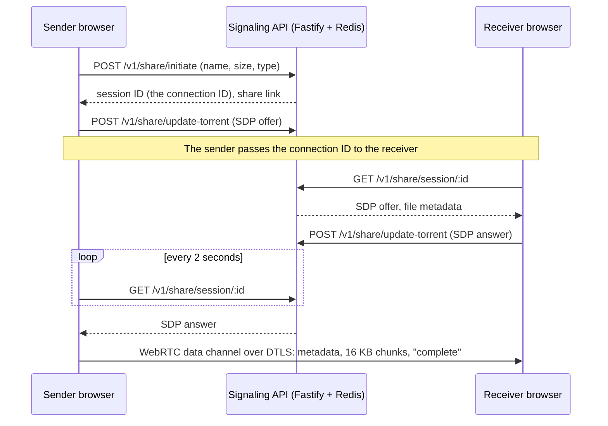

# SafeShare

Peer-to-peer file transfer over WebRTC. The sender's browser streams the file straight to the receiver's browser over a data channel, and a small signaling API only brokers the connection, so file contents never go through it. SafeShare is a prototype: see [Status](#status) for what works today.

<p align="center">
  
</p>

## How it works

There are two paths. The **signaling path** is JSON over HTTP between each client and the Fastify API, which keeps sessions in Redis. The **data path** is a direct WebRTC data channel between the two browsers.



1. The sender creates a session with the file's name, size and MIME type. The API stores it in Redis for 24 hours and returns a 16-character session ID, shown in the UI as the connection ID.
2. The sender opens an `RTCPeerConnection` with an ordered data channel and posts its SDP offer. The API keeps it in the session's `magnetUri` field (a leftover from the WebTorrent design), where the receiver's answer later replaces it.
3. The receiver enters the connection ID, fetches the offer and posts an answer. The sender polls for the answer every 2 seconds.
4. When the channel opens, the sender sends a JSON metadata message, the file as 16 KB `ArrayBuffer` chunks, then a `complete` message. The receiver rebuilds the file as a `Blob` and saves it.

NAT traversal uses Google's public STUN servers. No TURN relay is configured, so peers that cannot reach each other directly (for example, two behind symmetric NATs) will not connect.

**What the API sees:** the file name, size and MIME type; the SDP offer and answer, which carry each browser's DTLS certificate fingerprint and any ICE candidates (peer IP addresses); transfer status; and the client IP, a hash of which goes into the session ID. Sessions expire from Redis 24 hours after their last update.

**What the API does not receive:** file contents, since neither client uploads file data to it, and the DTLS keys, which each browser generates and keeps. A malicious signaling server could still read a transfer by intercepting the connection (see [Security model](#security-model)).

**Desktop client.** The Electron app uses the same API differently. Its main process seeds the file with WebTorrent and registers the real magnet URI with the session; the receiver's WebTorrent client downloads it into the Downloads folder. Peers are found through WebTorrent's default public trackers and the BitTorrent DHT. Because the web and desktop clients use different transports, they cannot send files to each other.

<p align="center">
  
  <br>
  <sub>Sender (left) after creating a session; receiver (right) joining with the connection ID.</sub>
</p>

## Security model

- **Encryption is WebRTC's DTLS, nothing more.** Browsers always run data channels over DTLS, so file bytes are encrypted between the two peers with keys from a per-connection DTLS handshake. Neither client adds application-layer encryption: the web client sends raw file chunks, and the desktop client seeds the original file.
- **The key exchange trusts the signaling server.** Each browser checks the DTLS handshake against the certificate fingerprint in the other side's SDP, and that SDP travels through the API. Session endpoints have no authentication, and the fingerprint is never checked out of band (no key or fingerprint travels in the link or URL fragment). A malicious or compromised signaling server, or anyone who knows a session ID, can replace the offer or answer and sit in the middle.
- **Session IDs are not random.** Each one is the first 16 hex characters of a SHA-256 over the user agent, the current millisecond timestamp and a truncated hash of the client IP, not output from a CSPRNG.
- **The server-side key pair is unused.** Creating a session also generates a libsodium `crypto_box` key pair: the public key is returned to the client and the private key is stored in Redis. Neither client uses these keys, and the chunk-encryption helpers in `apps/backend-fastify/src/utils/webrtc.ts` are never called. Because the server generates and holds the private key, wiring them in as written would still not be end-to-end encryption.
- **Desktop transfers are BitTorrent.** WebTorrent's TCP and uTP connections use BitTorrent protocol encryption (RC4 obfuscation that falls back to plaintext, WebTorrent's default), and its WebRTC peers use DTLS. Torrents are announced to public trackers and the DHT, so anyone who learns the magnet URI, the signaling server included, can download the file while the sender is seeding.

In short, web transfers are encrypted in transit between the two browsers and the signaling API never receives file contents, but confidentiality depends on trusting the signaling server. Desktop transfers may fall back to plaintext. The web app's "How It Works" page describes in-browser AES-GCM 256-bit encryption; that is not implemented.

## Apps

| Path                                           | What                                                                                                      | Stack                                    |
| ---------------------------------------------- | --------------------------------------------------------------------------------------------------------- | ---------------------------------------- |
| [`apps/web`](apps/web)                         | Web client: browser-to-browser transfer over a WebRTC data channel                                        | Next.js 16, React 19, shadcn/ui          |
| [`apps/electron`](apps/electron)               | Desktop client: WebTorrent transfers from the Electron main process                                       | Electron 45, React, Vite, WebTorrent     |
| [`apps/backend-fastify`](apps/backend-fastify) | Signaling API used by both clients                                                                        | Fastify, Redis                           |
| [`apps/backend-go`](apps/backend-go)           | Separate API with device auth, WebRTC rooms and server-relayed chunk uploads; not yet used by the clients | Go, Gin, sqlc, Postgres, Redis, RabbitMQ |

## Downloads

Desktop builds from the [latest release](https://github.com/piyush-gambhir/safeshare/releases/latest) (v0.1.1). They are unsigned and not notarized.

| Platform    | Download                                                                                                                            |
| ----------- | ----------------------------------------------------------------------------------------------------------------------------------- |
| macOS arm64 | [SafeShare-0.1.1-mac-arm64.zip](https://github.com/piyush-gambhir/safeshare/releases/download/v0.1.1/SafeShare-0.1.1-mac-arm64.zip) |
| Windows x64 | [SafeShare-0.1.1-win-x64.zip](https://github.com/piyush-gambhir/safeshare/releases/download/v0.1.1/SafeShare-0.1.1-win-x64.zip)     |
| Linux x64   | [SafeShare-0.1.1-linux-x64.zip](https://github.com/piyush-gambhir/safeshare/releases/download/v0.1.1/SafeShare-0.1.1-linux-x64.zip) |

SHA-256 sums are in [`checksums.txt`](https://github.com/piyush-gambhir/safeshare/releases/download/v0.1.1/checksums.txt). The Windows and Linux builds and transfers over the public internet have not been verified. The desktop app talks to the signaling API at `http://localhost:8000/v1`, which is fixed in `apps/electron/src/lib/api.ts`, so run the Fastify backend locally with `FRONTEND_URL='*'` (see below). Container images for the Go API are listed in [RELEASING.md](RELEASING.md).

## Quickstart

Requires Node 26 (`.nvmrc` pins 26.13.0), pnpm 12.15.0 (`corepack enable`) and Redis on `localhost:6379`.

```bash
pnpm install

# Signaling API on http://localhost:8000 (Swagger UI at /docs)
touch apps/backend-fastify/.env   # the dev script loads this file; it can stay empty
pnpm dev:backend-fastify

# Web client on http://localhost:3000
pnpm dev:web

# Desktop client (Vite dev server and an Electron window)
pnpm dev:electron
```

The backend's CORS policy only allows `FRONTEND_URL`. For the desktop client, start it with `FRONTEND_URL='*' pnpm dev:backend-fastify` instead; share links then lose their host, but the connection ID still works.

To try the web flow, open http://localhost:3000 in two windows. In the first, choose a file and click **Share File**; in the second, paste the connection ID and click **Join Session**.

| Variable                                     | App             | Default                    | Purpose                                       |
| -------------------------------------------- | --------------- | -------------------------- | --------------------------------------------- |
| `PORT`                                       | backend-fastify | `8000`                     | API port                                      |
| `REDIS_HOST`, `REDIS_PORT`, `REDIS_PASSWORD` | backend-fastify | `localhost`, `6379`, empty | Session store                                 |
| `FRONTEND_URL`                               | backend-fastify | `http://localhost:3000`    | CORS origin and base URL of share links       |
| `NEXT_PUBLIC_API_URL`                        | web             | `http://localhost:8000/v1` | Signaling API base URL, inlined at build time |

The Go API runs with `make docker-up` in `apps/backend-go` (Postgres, Redis, RabbitMQ, migrations, and the API on port 8080 with Swagger at `/swagger/index.html`).

CI ([`ci.yml`](.github/workflows/ci.yml)) lints and typechecks every Node app, runs the Electron transfer tests (a loopback WebTorrent seed and download with a byte comparison), and builds the web app, the Electron bundle and the Fastify backend.

## Status

This is a prototype. Known gaps:

- **Web transfers stall at "connecting".** The offer and answer are posted before ICE gathering finishes, and candidates gathered later are never sent, so the peers have no addresses to try. The sender also marks the session connected as soon as the answer arrives, before the data channel opens (`apps/web/components/file-transfer.tsx`).
- **The share link crashes.** `/receive/<id>` is left over from the WebTorrent design: it throws in the browser on load and expects a magnet URI rather than a WebRTC session. Receivers use the connection ID on the home page instead.
- **The desktop client's API URL is fixed** to `http://localhost:8000/v1`, it needs the wildcard CORS setting above, and its progress bar does not update.

## Docs

- [Upgrade review](docs/UPGRADE_REVIEW.md): toolchain, verification evidence, dependency advisories and release limits
- [Releasing](RELEASING.md): versioned container images
- [Security scanning](.github/SECURITY_SCANNING.md): CodeQL scope and the `ip` dependency override

## License

MIT
