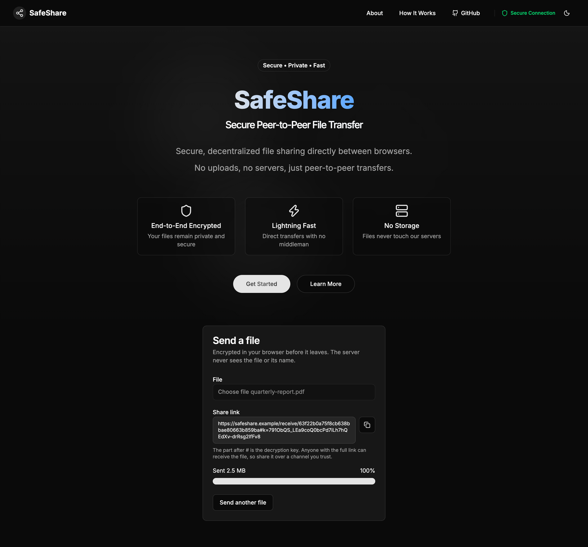
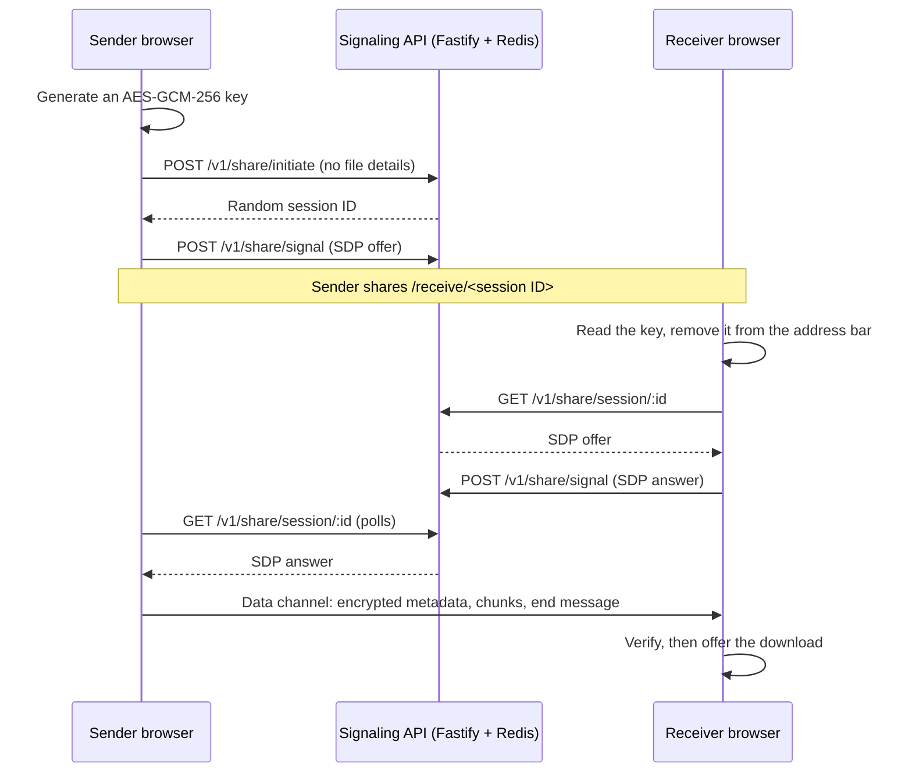
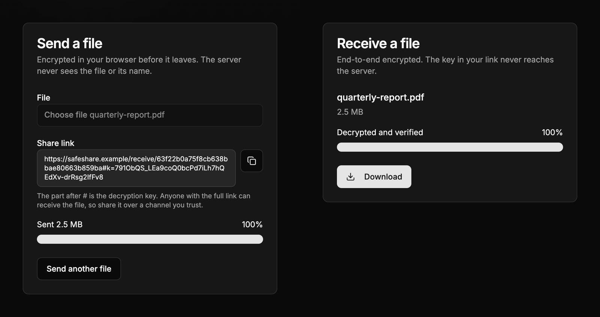

# SafeShare

End-to-end encrypted file transfer between two browsers. The sender's browser encrypts the file with a key that exists only in the share link's URL fragment and streams it straight to the receiver over WebRTC. A small signaling API introduces the two browsers and never sees the key, the file or its name.

<p align="center">
  
</p>

## How it works

There are two paths. The **signaling path** is JSON over HTTP between each browser and the Fastify API, which keeps sessions in Redis. The **data path** is a direct WebRTC data channel between the two browsers, and everything on it is encrypted with the key from the link.



1. The sender picks a file. Their browser asks the API for a session (it sends nothing about the file) and generates a fresh AES-GCM-256 key.
2. The sender's browser waits for ICE gathering to finish, posts its SDP offer, and shows the link `/receive/<session ID>#k=<key>`.
3. The receiver opens the link. Their browser reads the key from the fragment, removes it from the address bar, fetches the offer and posts an answer.
4. When the data channel opens, the sender streams an encrypted metadata message (name, size, type), the file as encrypted chunks with backpressure, and an encrypted end message. Every message fits in 64 KiB, the SCTP message size all WebRTC peers accept.
5. The receiver decrypts and checks every message, and shows the download button only after the end message verifies.

<p align="center">
  
  <br>
  <sub>Sender after the transfer (left); receiver with the decrypted, verified file (right).</sub>
</p>

## Security model

**What is end-to-end encrypted.** The file contents and its metadata (name, size and MIME type), using AES-GCM with a 256-bit key through WebCrypto ([`apps/web/lib/transfer-crypto.ts`](apps/web/lib/transfer-crypto.ts)).

- **Key.** The sender's browser generates a new key for every transfer and puts it, base64url-encoded, in the link's fragment (`#k=...`). Browsers never send the fragment to a server, and no code path posts or logs it. The receiver imports the key as decrypt-only and non-extractable, then removes the fragment from the address bar and the Next.js router state.
- **Messages.** Each data-channel message is `version || type || IV || ciphertext+tag`. The 96-bit IV is a random 4-byte prefix per sender plus a 64-bit sequence number, so it never repeats under a key. The additional authenticated data binds the protocol version, message type, sequence number and session ID, so an altered, reordered, duplicated, dropped or spliced message fails to decrypt.
- **Completeness.** The last message carries the chunk count and byte length, which must match what was received and the size in the metadata. Any failure aborts the transfer and discards what arrived; a partial file is never offered.
- WebRTC's DTLS also encrypts the transport. Because the content is encrypted with a key the server never has, a signaling server that tampers with the SDP can disrupt a transfer but cannot read it.

**What the signaling server still sees.** A random 128-bit session ID; the SDP offer and answer, including ICE candidates (IP addresses) and DTLS fingerprints; client IP addresses and request timing; and, like anyone on the network path, the approximate file size from the traffic volume. Sessions expire after 24 hours.

**Trust assumptions.**

- Anyone who holds the full link can receive the file, so share it over a channel you trust. The server accepts one answer per session, so the first receiver to connect wins and a link works once.
- There is no authentication beyond possession of the link, so the receiver cannot prove who sent the file.
- The JavaScript is served by whoever hosts the web app, and code from a malicious host could leak the key. This applies to any browser-based encryption.

**Not covered.** The desktop app transfers files with WebTorrent and has no application-layer encryption: BitTorrent peers use RC4 obfuscation that can fall back to plaintext, and torrents are announced to public trackers and the DHT, so anyone who learns the magnet URI (the signaling server included) can download the file while it is seeded. The Go API is not used by either client.

## Apps

| Path                                           | What                                                                                                      | Stack                                      |
| ---------------------------------------------- | --------------------------------------------------------------------------------------------------------- | ------------------------------------------ |
| [`apps/web`](apps/web)                         | Web client: end-to-end encrypted browser-to-browser transfers                                             | Next.js 16, React 19, shadcn/ui, WebCrypto |
| [`apps/electron`](apps/electron)               | Desktop client: WebTorrent transfers from the Electron main process (not end-to-end encrypted)            | Electron 45, React, Vite, WebTorrent       |
| [`apps/backend-fastify`](apps/backend-fastify) | Signaling API used by both clients                                                                        | Fastify, Redis                             |
| [`apps/backend-go`](apps/backend-go)           | Separate API with device auth, WebRTC rooms and server-relayed chunk uploads; not yet used by the clients | Go, Gin, sqlc, Postgres, Redis, RabbitMQ   |

## Downloads

Desktop builds from the [latest release](https://github.com/piyush-gambhir/safeshare/releases/latest) (v0.1.1). They are unsigned and not notarized, and they predate the web client's encryption, which they do not use.

| Platform    | Download                                                                                                                            |
| ----------- | ----------------------------------------------------------------------------------------------------------------------------------- |
| macOS arm64 | [SafeShare-0.1.1-mac-arm64.zip](https://github.com/piyush-gambhir/safeshare/releases/download/v0.1.1/SafeShare-0.1.1-mac-arm64.zip) |
| Windows x64 | [SafeShare-0.1.1-win-x64.zip](https://github.com/piyush-gambhir/safeshare/releases/download/v0.1.1/SafeShare-0.1.1-win-x64.zip)     |
| Linux x64   | [SafeShare-0.1.1-linux-x64.zip](https://github.com/piyush-gambhir/safeshare/releases/download/v0.1.1/SafeShare-0.1.1-linux-x64.zip) |

SHA-256 sums are in [`checksums.txt`](https://github.com/piyush-gambhir/safeshare/releases/download/v0.1.1/checksums.txt). The Windows and Linux builds and transfers over the public internet have not been verified. The desktop app talks to the signaling API at `http://localhost:8000/v1`, which is fixed in `apps/electron/src/lib/api.ts`, so run the Fastify backend locally with `FRONTEND_URL='*'` (see below). Container images for the Go API are listed in [RELEASING.md](RELEASING.md).

## Quickstart

Requires Node 26 (`.nvmrc` pins 26.13.0), pnpm 12.15.0 (`corepack enable`) and Redis on `localhost:6379`.

```bash
pnpm install

# Signaling API on http://localhost:8000 (Swagger UI at /docs)
touch apps/backend-fastify/.env   # the dev script loads this file; it can stay empty
pnpm dev:backend-fastify

# Web client on http://localhost:3000
pnpm dev:web

# Desktop client (Vite dev server and an Electron window)
pnpm dev:electron
```

To try a transfer, open http://localhost:3000, choose a file, click **Create share link**, and open the link in another browser window. WebCrypto only works in a secure context, so serve the web app over HTTPS anywhere other than `localhost`.

The backend's CORS policy only allows `FRONTEND_URL`. For the desktop client, start it with `FRONTEND_URL='*' pnpm dev:backend-fastify` instead.

| Variable                                     | App             | Default                    | Purpose                                         |
| -------------------------------------------- | --------------- | -------------------------- | ----------------------------------------------- |
| `PORT`                                       | backend-fastify | `8000`                     | API port                                        |
| `REDIS_HOST`, `REDIS_PORT`, `REDIS_PASSWORD` | backend-fastify | `localhost`, `6379`, empty | Session store                                   |
| `FRONTEND_URL`                               | backend-fastify | `http://localhost:3000`    | CORS origin (and the desktop app's share links) |
| `NEXT_PUBLIC_API_URL`                        | web             | `http://localhost:8000/v1` | Signaling API base URL, inlined at build time   |

The Go API runs with `make docker-up` in `apps/backend-go` (Postgres, Redis, RabbitMQ, migrations, and the API on port 8080 with Swagger at `/swagger/index.html`).

`pnpm --filter ./apps/web test` runs the encryption unit tests. CI ([`ci.yml`](.github/workflows/ci.yml)) also lints and typechecks every Node app, runs the Electron transfer tests, and builds the web app, the Electron bundle and the Fastify backend.

## Status

This is a prototype. Known gaps:

- **No relay.** Only STUN is configured, so two devices that cannot reach each other directly (for example, both behind symmetric NATs) will not connect.
- **Memory-bound receiving.** The receiver holds the whole file in memory until it is saved.
- **One shot per link.** Each link serves one receiver, and an interrupted transfer starts over with a new link.
- **Desktop client.** Its API URL is fixed to `http://localhost:8000/v1`, it needs the wildcard CORS setting above, its progress bar does not update, and it cannot exchange files with the web client.

## Docs

- [Upgrade review](docs/UPGRADE_REVIEW.md): toolchain, verification evidence, dependency advisories and release limits
- [Releasing](RELEASING.md): versioned container images
- [Security scanning](.github/SECURITY_SCANNING.md): CodeQL scope and the `ip` dependency override

## License

MIT
